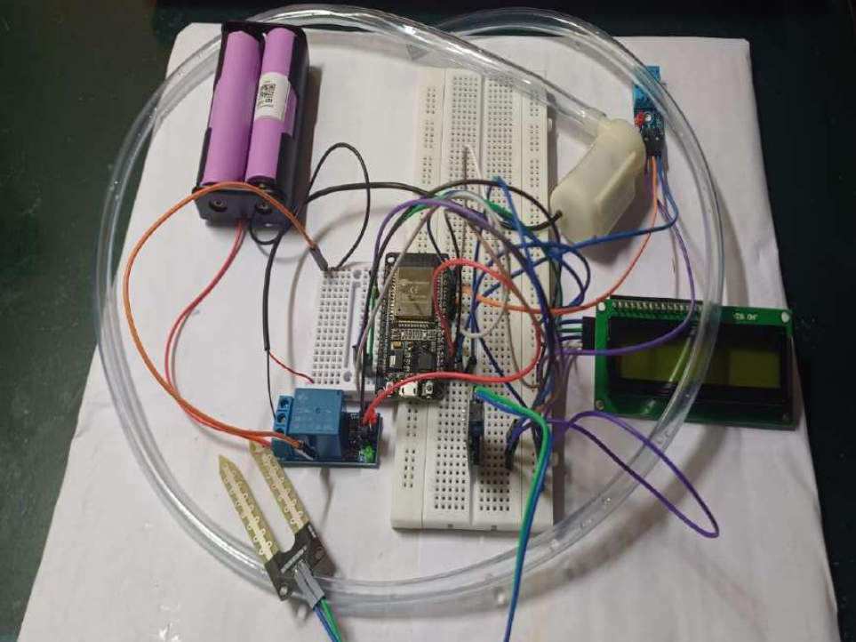
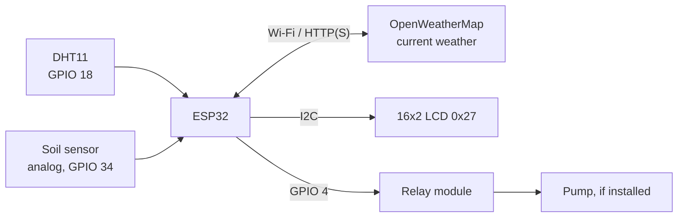

# ESP32-Based Weather Monitoring and Smart Irrigation System

An ESP32 (Arduino framework) project that reads local temperature, humidity and soil moisture, fetches current weather for a configured city from OpenWeatherMap, shows the data on a 16x2 I2C LCD, and commands a relay that is intended to switch an irrigation pump. The firmware commands the pump **OFF** unless every input is valid and fresh.

> **Status:** academic/hobby prototype. The firmware was reviewed and refactored without access to the hardware or an ESP32 toolchain. It has **not been compiled for an ESP32 or run on hardware** since the refactor. See [Testing and validation status](#testing-and-validation-status).



*Photograph of the author's prototype breadboard (ESP32 board, relay module, small pump, soil probe, DHT module, I2C LCD, battery holder). It is provided as-is; exact parts and wiring are not independently verified.*

## Problem and intended application

Fixed-schedule watering wastes water when it rains or the soil is already moist. This prototype combines a local soil reading with online weather data so the pump is only commanded ON when the soil is dry and no rain is reported. This is the *intended* application; no water-saving effect has been measured.

## How it works



1. The non-blocking main loop reads the DHT11 and soil ADC every 2 s.
2. Weather is requested every 10 min (retry after 60 s on failure) and parsed with validation.
3. Every second, `decideIrrigation()` ([irrigation_logic.h](irrigation_logic.h)) turns the readings into a pump command.
4. The LCD cycles through three pages every 3 s.

More detail: [docs/system-architecture.md](docs/system-architecture.md), [docs/firmware-and-control-logic.md](docs/firmware-and-control-logic.md).

## Features (implemented in source)

- Local DHT11 temperature/humidity and raw soil-moisture ADC readings, with validation.
- OpenWeatherMap current-weather request: timeout, HTTP status handling, JSON validation, optional HTTPS with certificate verification.
- Rain handled as three states (none / detected / unknown); a failed request is never treated as "no rain".
- Fail-safe pump command with hysteresis, run-time limit and cooldown.
- Bounded, non-blocking Wi-Fi reconnect with exponential backoff.
- Flicker-free 16x2 LCD pages showing readings, pump *command*, and fault reason.
- Credentials kept out of source (`secrets.h`, git-ignored).
- Host-side unit tests for the decision logic.

## Technology stack

C++ / Arduino framework on ESP32. Libraries (versions not pinned; see [setup](docs/setup-and-configuration.md)): `WiFi`, `HTTPClient`, `WiFiClientSecure` (ESP32 core), `Arduino_JSON`, `DHT sensor library` (Adafruit), `Wire`, `LiquidCrystal_I2C`.

## Hardware

| Part | Notes (unverified beyond source/photo) |
|---|---|
| ESP32 development board | Exact board/module not established |
| DHT11 module | Data on GPIO 18 |
| Analog soil-moisture sensor | Output on GPIO 34 |
| 1-channel relay module | Input on GPIO 4; firmware assumes **active-low** |
| 16x2 I2C LCD | Address 0x27 |
| Small DC pump, tubing, separate pump supply | Ratings unknown |

### Pin mapping

| Signal | GPIO | Defined in |
|---|---|---|
| DHT11 data | 18 | `DHT_PIN` |
| Soil analog out | 34 (input only, ADC1) | `MOISTURE_SENSOR_PIN` |
| Relay input | 4 (LOW = ON, HIGH = OFF) | `RELAY_PIN`, `RELAY_ON_LEVEL` |
| LCD SDA/SCL | Board default `Wire.begin()` (commonly 21/22 on ESP32 DevKit; **verify**) | `Wire.begin()` |

Full wiring notes and checks: [docs/hardware-and-wiring.md](docs/hardware-and-wiring.md).

## Setup

1. Install Arduino IDE 2.x, the **esp32 by Espressif** board package, and the libraries listed above.
2. Open `weatherapi_mpmcproject_01.ino`. (Arduino IDE needs the sketch in a folder with the same name; it offers to create it. `irrigation_logic.h` and `secrets.h` must sit next to the `.ino`.)
3. Create your local config:
   ```bash
   cp secrets.example.h secrets.h
   ```
   Edit `secrets.h`: `WIFI_SSID`, `WIFI_PASSWORD`, `WEATHER_API_KEY` ([get a key](https://openweathermap.org/api)), `WEATHER_CITY`. **Never commit `secrets.h`.**
4. Select your ESP32 board and port, compile, upload.
5. Open the Serial Monitor at **115200 baud**.
6. **Before connecting a pump**, follow the checklist in [docs/hardware-and-wiring.md](docs/hardware-and-wiring.md) (relay polarity, soil ADC direction, LCD address).

Full guide: [docs/setup-and-configuration.md](docs/setup-and-configuration.md).

## Weather request and parsing

`GET /data/2.5/weather?q=<city>&appid=<key>&units=metric`. Required fields: `main.temp`, `main.humidity` (type- and range-checked). Rain: `rain.1h` (or `rain.3h`) in mm; absent `rain` in a valid response means none reported; weather condition ids 200-531 also count as rain. The request URL and key are never printed. See [docs/weather-api-integration.md](docs/weather-api-integration.md). HTTPS is optional (`WEATHER_USE_HTTPS`) and needs a root CA you supply; the default is plain HTTP as in the original code, which sends the API key unencrypted.

## Irrigation logic

Pump command is ON only if **all** hold: Wi-Fi connected, fresh valid DHT reading, valid soil reading, fresh weather (< 25 min old), rain state known and not raining, soil dry, not in cooldown, run time < limit.

| Setting | Default | Meaning |
|---|---|---|
| `SOIL_DRY_ADC` | 2000 | Raw ADC threshold (not a percentage). Original value. |
| `SOIL_HYSTERESIS_ADC` | 200 | Pump stays ON until soil passes threshold + this. Uncalibrated starting value. |
| `SOIL_HIGHER_IS_DRIER` | false | Original code treats low ADC as dry. **Many resistive probes behave the opposite way; verify.** |
| `AMBIENT_TRIGGERS` | false | If true, restores the original rule where temperature > 30 °C or humidity < 40 % alone starts the pump. |
| `PUMP_MAX_RUN_MS` / `PUMP_COOLDOWN_MS` | 60 s / 10 min | Placeholders. Tune with real hardware. |

**Behaviour change:** the original used `soil < 2000 OR temp > 30 OR humidity < 40`, so hot or dry air could water already-moist soil. The default is now soil-gated; set `AMBIENT_TRIGGERS true` to restore the old rule. Rationale: [docs/firmware-and-control-logic.md](docs/firmware-and-control-logic.md).

## LCD pages (3 s each)

1. `Loc 24.5C 55%` / `Soil ADC: 1834`
2. `API 25.1C 60%` / `Rain: none|yes|unknown` (or `API: no data`)
3. `Pump cmd: OFF` / reason text (e.g. `No Wi-Fi`, `Soil dry`)

"Pump cmd" is what the firmware commanded, not confirmation the pump runs.

## Testing and validation status

| Check | Status |
|---|---|
| Decision-logic unit tests (host g++, 39 checks) | Passed in the authoring environment |
| Sketch syntax check against **host stubs** | Passed (stubs encode assumptions; not a real build) |
| Secret scan of the working tree | Passed |
| Compile with Arduino CLI / ESP32 core | **Not performed** (toolchain unavailable) |
| Live OpenWeatherMap request | **Not performed** (network blocked) |
| Hardware tests (relay, ADC, LCD, DHT, pump) | **Not performed** |

Run host checks: `tests/run_tests.sh`. Hardware checklist: [docs/testing-and-troubleshooting.md](docs/testing-and-troubleshooting.md).

## Known limitations

- Soil threshold is raw ADC; no calibrated moisture percentage.
- DHT11 is low accuracy; local temperature/humidity are only used by the optional legacy rule, but a DHT fault still forces pump OFF.
- No persistent logging; state is lost on reset.
- Plain HTTP by default. `lcd.begin()` depends on the LiquidCrystal_I2C variant (`LCD_USE_INIT` switches to `init()`).
- No physical validation; pump specs and safe run times unknown.

## Safety warnings

Software cannot guarantee physical safety. Keep water away from mains electricity, power the pump from a suitable separate supply, check the relay's ratings, add independent protection (fuse, manual cutoff, overflow protection), and read [docs/safety-and-limitations.md](docs/safety-and-limitations.md). The ESP32 GPIO state during reset/boot may briefly differ from the firmware's OFF level; verify with your relay module.

## Documentation

[Overview](docs/project-overview.md) · [Architecture](docs/system-architecture.md) · [Hardware](docs/hardware-and-wiring.md) · [Firmware](docs/firmware-and-control-logic.md) · [Weather API](docs/weather-api-integration.md) · [Setup](docs/setup-and-configuration.md) · [Testing](docs/testing-and-troubleshooting.md) · [Safety](docs/safety-and-limitations.md) · [Course context](docs/course-project-context.md) · [Roadmap](docs/roadmap.md) · [Licensing](docs/licensing.md) · [Contributing](CONTRIBUTING.md) · [Security](SECURITY.md) · [Changelog](CHANGELOG.md)

## Sustainable development relevance

Built as a BECE204L course project, the intended relevance is responsible water use in agriculture (SDG 6, SDG 2). No impact has been measured or certified. See [docs/course-project-context.md](docs/course-project-context.md).

## Future work

See [docs/roadmap.md](docs/roadmap.md) (calibration, HTTPS cert provisioning, hardware test results, data logging). These are not implemented.

## License and author

No license file exists yet, so default copyright applies and no reuse permission is granted; the owner must choose a license ([docs/licensing.md](docs/licensing.md)). Repository owner: [yash-mehta13](https://github.com/yash-mehta13).
