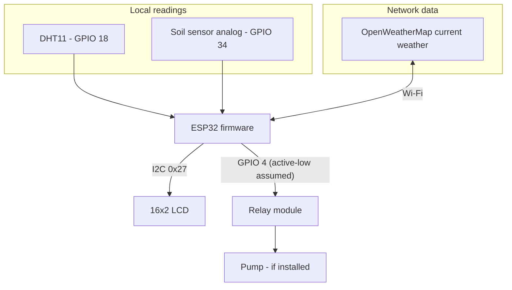
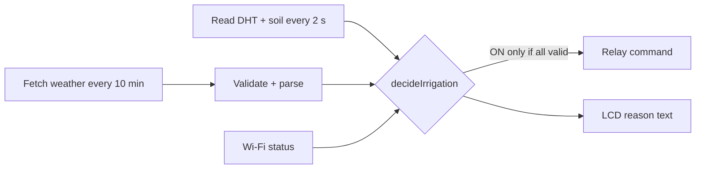

# System Architecture

## Block diagram

## Data flow

**Local vs API data:** local temperature, humidity and soil ADC come from the sensors; API temperature, humidity and rain come from OpenWeatherMap for the configured city. API temperature/humidity are displayed only; they are not used in the pump decision. API rain is. Local temperature/humidity are used only by the optional legacy rule (`AMBIENT_TRIGGERS`).

The pump and its wiring are the *intended* architecture; the source cannot confirm them.
